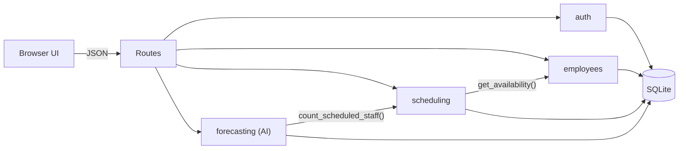

# Architecture

_Owner: Lead Architect_

> Outline to fill in as the system takes shape. Keep the diagrams current as modules change.

## Overview

ShiftWise AI is a Flask application split into modules (blueprints). Each module has a
`routes.py` (HTTP layer) and a `service.py` (business logic). Modules talk to each other only
through **service functions**, never by querying another module's tables. This follows the
**decomposition** principle from the proposal.

Starting diagram (update it as you go; GitHub renders Mermaid):

## Module responsibilities

| Module | Owns tables | Depends on | Functions other modules call |
|--------|-------------|------------|------------------------------|
| auth | `users` | — | `login_required`, `role_required`, `create_user` |
| employees | _TODO_ | — | _TODO_ |
| scheduling | _TODO_ | employees | _TODO_ |
| forecasting | _TODO_ | scheduling | _TODO_ |

Keep dependencies one-directional (forecasting → scheduling → employees) to avoid circular
imports.

## Key flows

_TODO: add a sequence diagram for each main workflow._

- Unexpected absence → shift opens → replacements ranked → manager approves
- Staffing forecast → compare with the schedule → show understaffed days

## Data model

_TODO: describe each table once it's added to [app/schema.sql](../app/schema.sql), ideally as
a Mermaid `erDiagram`._

## Cross-cutting concerns

- **Configuration:** `app/config.py`, read from environment variables (see `.env.example`)
- **Errors:** services raise `ValidationError` / `NotFoundError` / `ConflictError`, which
  `app/errors.py` turns into JSON 400/404/409 responses; stubs return 501
- **Security:** hashed passwords, HttpOnly and SameSite session cookies, `role_required` on
  manager routes, parameterized SQL, `esc()` for HTML output
- _TODO: logging, performance decisions, anything else the team decides_
